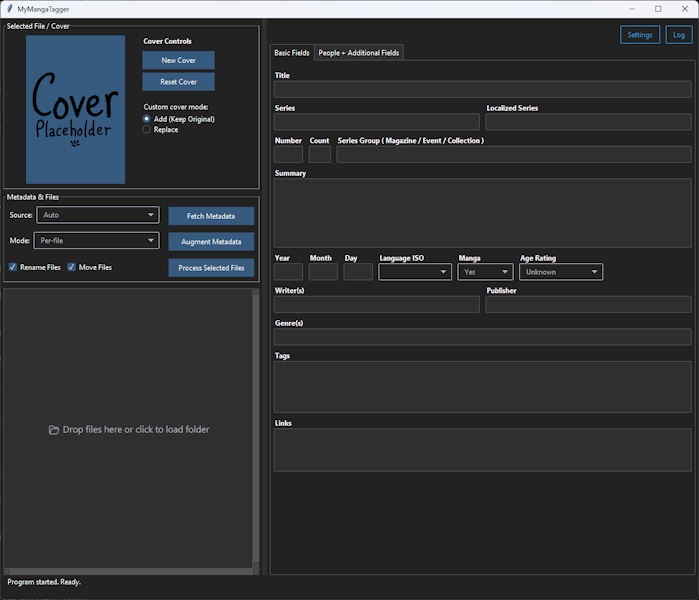
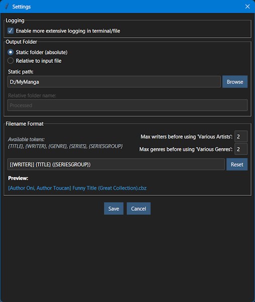

# MyMangaTagger

[](images/gui-preview.png)

**MyMangaTagger** is a Python desktop application for editing, enriching, and organizing manga metadata in `.cbz` archives. It can read existing `ComicInfo.xml` metadata, fetch series information from online sources, add volume-specific details from publishers, and process multiple files through a drag-and-drop interface.

The project is heavily inspired by [MangaManager](https://github.com/MangaManagerORG/Manga-Manager). It is a personal learning and experimentation project developed with substantial AI assistance.

## Features

- **CBZ library management:** Load `.cbz` and `.zip` files using drag-and-drop or a folder picker, and read existing `ComicInfo.xml` metadata.
- **Online metadata:** Fetch manga information from [AniList](https://anilist.co/) and [MangaBaka](https://mangabaka.org/), with optional automatic source detection from the URL.
- **Flexible batch fetching:** Fetch metadata separately for each file, or fetch once and apply it to a selection with automatic volume numbering.
- **Volume metadata augmentation:** Supplement series-level metadata with volume-specific titles, summaries, and release dates from supported publishers.
- **Metadata editor:** Edit ComicInfo fields individually or across several selected archives, including additional people and story-related fields.
- **Cover management:** Add a custom cover while keeping the original pages, or replace the first image in an archive.
- **File organization:** Rename archives using a configurable filename template and optionally move them into series folders.
- **Efficient archive processing:** Rewrite archives without extracting their contents to temporary folders, and convert WebP images to PNG when processing.
- **Built-in diagnostics:** View, filter, and search application logs from the GUI.

## Requirements and installation

- Python **3.12 or newer**, with Tkinter available.
- The packages listed in `requirements.txt`.
- An internet connection for fetching and augmenting metadata.

The application is primarily developed for Windows. There is no separate installer in this source distribution.

1. Download or clone the repository and open a terminal in the application directory (the folder containing `run.pyw`).
2. Create and activate a virtual environment (recommended on Windows):

   ```powershell
   python -m venv .venv
   .\.venv\Scripts\Activate.ps1
   ```

3. Install the dependencies:

   ```powershell
   python -m pip install -r requirements.txt
   ```

4. Start the application:

   ```powershell
   python run.pyw
   ```

   On Windows, you can also launch `run.pyw` directly if `.pyw` files are associated with Python.

## Getting started

1. **Load your archives.** Drag `.cbz` or `.zip` files (or a folder) into the file list, or click the empty file list to choose a folder. ZIP archives are renamed to `.cbz` when loaded; folder scanning does not include subfolders.
2. **Select files.** Select one or more archives from the list. Existing `ComicInfo.xml` values are loaded into the editor when available.
3. **Fetch metadata (optional).** Choose a source and fetch mode, then click **Fetch Metadata**. Paste or drop a supported series URL into the dialog.
4. **Review and edit.** Adjust titles, numbers, creators, genres, descriptions, and other metadata as needed. Changes to fields are applied to all currently selected files.
5. **Augment volume metadata (optional).** Click **Augment Metadata**, provide a supported publisher URL, review the preview, and apply updates to matching volumes.
6. **Choose a cover (optional).** Drag an image onto the cover preview or click **New Cover**. Select **Add (Keep Original)** or **Replace**.
7. **Process your files.** Choose whether to **Rename Files** and/or **Move Files**, then click **Process Selected Files** to write the updated `ComicInfo.xml` and perform the selected file operations.

> [!IMPORTANT]
> Processing modifies the archive itself. Keep a backup of your original files, especially before batch processing or replacing cover images.

## Fetching metadata

MyMangaTagger supports two public metadata sources:

| Source | Integration | Typical metadata |
| --- | --- | --- |
| [AniList](https://anilist.co/) | GraphQL API | Series titles, descriptions, genres, tags, staff, dates, and relevant links |
| [MangaBaka](https://mangabaka.org/) | REST API | Series and localized titles, authors/artists, publishers, genres, tags, dates, and links; AniList data can supplement certain fields |

Select **Auto** to let the application identify the source from the entered URL, or choose a specific source manually. In per-file mode, the filename is copied to the clipboard to make searching easier. The URL dialog shows the filename and a cover preview, and supports skipping an individual file or cancelling the remaining fetches.

### Fetch modes

| Mode | Behavior |
| --- | --- |
| **Per-file** | Prompts for a URL for each selected file and fetches metadata separately. This is the default mode when the application starts. |
| **One URL → All** | Fetches metadata once, then applies it to every selected file. A dialog lets you change the base title, select the starting volume number, and preview the result. |

In **One URL → All** mode, selected files are numbered in their current list order. For example, with a base title of `Example Series` and a starting number of `3`, the generated metadata is:

| ComicInfo `Number` | ComicInfo `Title` |
| --- | --- |
| `3` | `Example Series, Vol. 3` |
| `4` | `Example Series, Vol. 4` |
| `5` | `Example Series, Vol. 5` |

The shared series metadata is reused; the `Title` and `Number` are updated for each selected file.

## Volume metadata augmentation

Series databases often provide information for an entire manga rather than for individual volumes. **Augment Metadata** adds volume-specific information from official publisher pages to metadata you have already loaded or fetched.

Supported publishers:

| Publisher | Source |
| --- | --- |
| J-Novel Club | [j-novel.club](https://j-novel.club/) |
| Yen Press | [yenpress.com](https://yenpress.com/) |
| Seven Seas Entertainment | [sevenseasentertainment.com](https://sevenseasentertainment.com/) |
| Kodansha USA | [kodansha.us](https://kodansha.us/) |
| One Peace Books | [onepeacebooks.com](https://www.onepeacebooks.com/) |

**How it works:**

1. Select the CBZ files you want to update. Their ComicInfo **Number** fields must already contain the appropriate volume numbers.
2. Click **Augment Metadata** and enter a supported publisher series URL.
3. MyMangaTagger looks up available volumes and matches them to the selected files by volume number.
4. A preview shows the existing and proposed titles, summary-change status, dates, and whether each file matched.
5. Click **Apply** to update the metadata in the editor, or **Cancel** to leave it unchanged.

The augmenter can update **Title**, **Summary**, **Year**, **Month**, and **Day**:

- A volume-specific subtitle, when available, is appended to the existing title.
- A publisher summary replaces the existing summary when one is available.
- Release-date fields are updated when the publisher provides date information. Some sources, such as One Peace Books, provide only a year and clear the month/day fields.
- Files without a matching volume number are not changed.

Augmentation updates the metadata held in the application. Use **Process Selected Files** afterward to save those changes into the archives.

> [!NOTE]
> Publisher pages and APIs can change. The availability and completeness of volume metadata depend on what each publisher exposes.

## Editing ComicInfo metadata

The editor groups its fields into **Basic Fields** and **People + Additional Fields** tabs. These include titles, series and volume numbers, summaries, publication dates, publisher, language, genres, tags, links, creator roles, characters, and story-related information.

When you select multiple files, fields with the same value can be edited together, while differing values are marked separately. Editing a field updates that field for all selected archives without requiring you to fetch the metadata again.

Metadata is stored as `ComicInfo.xml` inside each processed CBZ archive.

## Cover management

Select a file, then drop an image onto the cover preview or click **New Cover**. Supported input image types include JPG, JPEG, PNG, GIF, and WebP.

| Mode | Result when processing |
| --- | --- |
| **Add (Keep Original)** | Adds the selected image as `00000!__cover.png` inside the archive and keeps the existing pages. |
| **Replace** | Replaces the first image entry in the archive with the selected cover, saved as PNG. |

**Reset Cover** clears a custom cover selection that has not yet been processed and returns the preview to the cover in the archive. It does not undo a cover change already saved to a processed file.

## Renaming and organizing files

The **Rename Files** and **Move Files** options work independently. You can write metadata without renaming or moving, rename without moving, or perform both operations.

### Filename templates

Configure the filename template in **Settings**. The default pattern is:

```text
[{WRITER}] {TITLE} ({SERIESGROUP})
```

Supported tokens:

| Token | Value |
| --- | --- |
| `{TITLE}` | Metadata title, falling back to the original filename if missing |
| `{WRITER}` | Writer names, subject to the configured filename limit |
| `{GENRE}` | Genres, subject to the configured filename limit |
| `{SERIES}` | Series name |
| `{SERIESGROUP}` | Series group, magazine, event, or collection |

Empty parentheses/brackets and invalid filename characters are cleaned up automatically. The template editor includes a live preview and a **Reset** button.

The **Max writers** and **Max genres** settings control how many names are included in generated filenames before they are replaced with `Various Artists` or `Various Genres`. Set either limit to `0` to include all values. These limits affect filenames, not the underlying ComicInfo metadata.

Titles fetched from metadata sources preserve their original capitalization, apart from whitespace cleanup. If no title is available, the original filename is used with smart title casing.

### Output folders

When **Move Files** is enabled, choose one of the following in **Settings**:

- **Relative (default):** Move files into a subfolder of the original file's directory, named `Processed` by default.
- **Static:** Move files into a specified absolute output directory.

If a file has a **Series** value, MyMangaTagger creates a subfolder named after that series inside the chosen output folder. For example:

```text
Manga/
└── Processed/
    └── Example Series/
        ├── Example Series, Vol. 1.cbz
        └── Example Series, Vol. 2.cbz
```

The filenames above are illustrative; actual names depend on your selected filename template.

## Archive processing

MyMangaTagger processes CBZ files as ZIP archives without extracting all their contents into a temporary directory:

- It writes updated `ComicInfo.xml` metadata into the archive.
- When no custom cover is selected and no WebP images are present, page-image bytes are preserved.
- When necessary, the archive is rebuilt in a streaming workflow. Image entries are stored without ZIP recompression, while `ComicInfo.xml` is compressed.
- WebP images in an archive are converted to PNG during processing. Custom cover images are also saved as PNG.
- Renaming and moving, when enabled, happen after the archive has been updated.

## Settings and logs

[](images/settings-preview.png)

The **Settings** dialog controls the output folder, filename template, writer/genre filename limits, and debug logging. Settings are saved locally in `settings.json` in the application directory.

The built-in **Log** viewer can filter messages by severity, search within messages, automatically refresh, and clear its in-memory log display. Debug logging can be enabled for more detailed diagnostic output in the console and log file.

## Project structure

```text
MyMangaTagger/
├── run.pyw                       # Application entry point
├── requirements.txt              # Python dependencies
├── assets/
│   └── default_cover.png         # Fallback cover image
├── gui/
│   ├── main_window.py            # Main GUI and application workflow
│   ├── augment_metadata_dialog.py # Publisher URL and preview dialogs
│   ├── batch_apply_dialog.py     # Shared metadata and volume numbering
│   ├── settings_dialog.py        # Application settings
│   ├── url_dialog.py             # Source URL prompt
│   ├── log_viewer.py             # Log viewer
│   └── panels/                   # File list, cover, and action panels
├── services/
│   ├── file_io.py                # ComicInfo and CBZ archive handling
│   ├── cover_manager.py          # Cover preview and caching
│   ├── normalization.py          # Metadata and filename cleanup
│   ├── templating.py             # Filename formatting
│   ├── config.py                 # Persistent settings
│   ├── constants.py              # Shared defaults and field choices
│   └── logger.py                 # Application logging
├── sources/
│   ├── base.py                   # Metadata source interface and registry
│   ├── loader.py                 # Automatic source discovery
│   ├── router.py                 # Source selection from URLs
│   ├── anilist.py                # AniList integration
│   ├── mangabaka.py              # MangaBaka integration
│   └── _template.py              # Starting point for a new source
└── augmenters/
    ├── base.py                   # Shared volume patching and preview logic
    ├── jnovel_club.py
    ├── yen_press.py
    ├── seven_seas.py
    ├── kodansha.py
    └── one_peace_books.py
```

Runtime files such as `settings.json` and `mymangatagger.log` are created locally and are not required in a fresh checkout.

### Extending metadata sources

Metadata sources use a small adapter interface and are automatically discovered when their modules are placed in `sources/`. See [`sources/_template.py`](sources/_template.py) for an example of how to register a source, recognize its URLs, and map results into ComicInfo-compatible fields.

## Acknowledgements and usage

MyMangaTagger is a personal project developed for learning and experimentation, with heavy use of AI assistance, and is inspired by [MangaManager](https://github.com/MangaManagerORG/Manga-Manager).

Metadata and publisher information remain subject to the terms of the respective source websites and APIs. The repository's license, if one is provided, governs reuse and redistribution of the application's source code.
